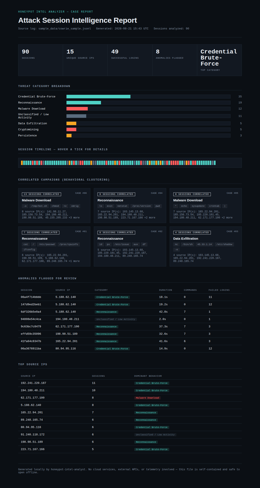

# Honeypot Intel Analyzer

I run a Cowrie SSH/Telnet honeypot as part of my [honeynet stack](../), and it generates way more log noise than I can realistically read through by hand — mostly bots trying the same handful of credentials and dropping the same handful of scripts. This is a small tool that reads those logs and turns them into something I'd actually look at: which sessions are just noise, which ones are the same campaign hitting me from different IPs, and which ones are actually weird.

No cloud, no API keys, nothing to sign up for. `pip install`, run the script, open the HTML file it spits out.



**[Example report](https://htmlpreview.github.io/?https://github.com/r-morato/docker-honeynet/blob/main/analyzer/docs/example-report.html)** — built from the synthetic sample data that ships in this repo, so you can see what it looks like without running anything.

## What it actually does

There are three passes over the data:

- **Tagging** — a set of rules looks at the commands each session ran and buckets it: recon, brute-force, malware download, cryptomining, persistence, exfiltration, or "nothing much happened."
- **Clustering** — a TF-IDF + KMeans pass groups sessions that behave the same way, so if the same botnet script gets run from fifteen different IPs, it shows up as one campaign instead of fifteen separate log lines.
- **Anomaly detection** — an Isolation Forest flags sessions that are statistical outliers, mostly to catch stuff the rules above wouldn't know to look for.

None of this needed to be a cloud service — it's a few hundred sessions at most, runs in under a second on a laptop, and everything ends up in one HTML file you can just open.

## Quick start

```bash
git clone https://github.com/r-morato/docker-honeynet.git
cd docker-honeynet/analyzer
pip install -r requirements.txt

# Try it on the included synthetic sample data
python analyze.py --log sample_data/cowrie_sample.jsonl --out output/report.html

# Or point it at a real Cowrie log
python analyze.py --log /path/to/cowrie.json --out output/report.html
```

Then just open `output/report.html`.

Don't have a Cowrie log handy? Run `scripts/generate_sample_data.py` and it'll generate a realistic fake one (90 sessions, all the attack categories represented) so you can try the whole thing out in a minute or two.

## What's in the report

- A breakdown of attack types by volume
- A timeline strip — one tick per session, color-coded, hover for details
- The correlated campaigns, with their signature commands and which IPs were involved
- Whatever got flagged as anomalous
- A table of the noisiest source IPs and what they were mostly doing

## How it works

```
Cowrie JSONL log
      │
      ▼
 src/parser.py        groups raw events into per-session records
      │                (src IP, commands, login attempts, duration)
      ▼
 src/classifier.py    ├─ rule-based category + severity tagging
                       ├─ TF-IDF + KMeans campaign clustering
                       └─ Isolation Forest anomaly scoring
      │
      ▼
 src/report.py        renders one self-contained HTML file
```

Worth noting: everything in that log — commands, usernames, IPs — was typed by an attacker, so it's untrusted by definition. Everything gets HTML-escaped before it's dropped into the report, otherwise you'd have a fun little XSS problem baked into your own tooling.

## Project structure

```
analyzer/
├── analyze.py                       # CLI entrypoint
├── src/
│   ├── parser.py                    # Cowrie JSONL → session records
│   ├── classifier.py                # tagging, clustering, anomaly detection
│   └── report.py                    # static HTML report generation
├── scripts/
│   └── generate_sample_data.py      # synthetic Cowrie log generator
├── sample_data/
│   └── cowrie_sample.jsonl          # 90-session demo log
└── docs/
    └── example-report.html          # pre-generated example output
```

## Why not just use rules?

Honestly, rules alone get you most of the way there. But they can only catch what you already thought to write a pattern for. Clustering picks up campaigns you didn't know to look for, and the anomaly detection catches the "huh, that's odd" sessions that don't match anything — including stuff that might be genuinely new. Felt worth the extra bit of complexity.

## Ideas I haven't gotten to

- Pipe sessions through a local LLM (Ollama or similar) to write actual incident narratives instead of my template sentences
- Geo-tag the source IPs using an offline GeoLite2 database
- Export flagged sessions in a STIX/MISP format so they're usable elsewhere
- A live-tail mode instead of run-once

## License

MIT
